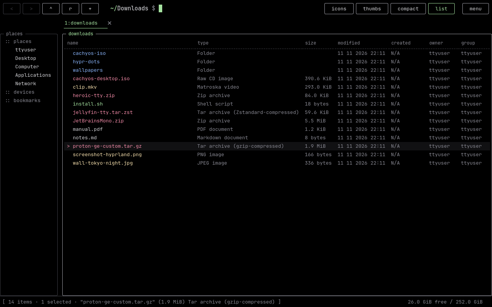
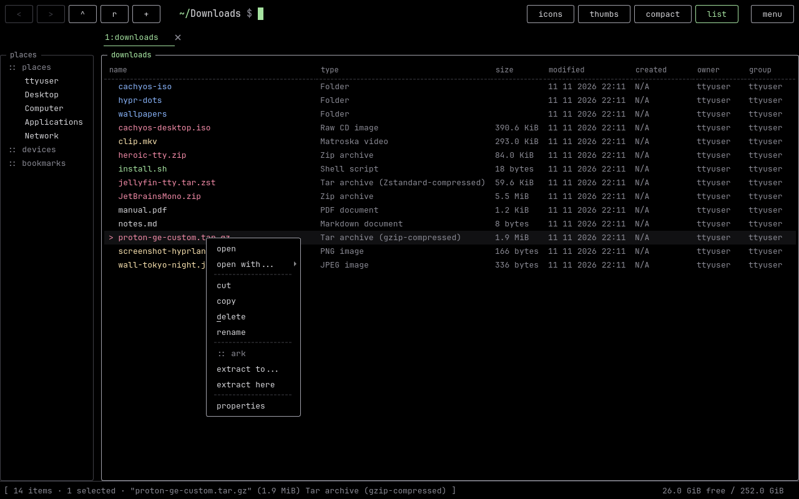

<div align="center">

# 「 ✨ pcmanfm-tty ✨ 」

**a minimalist, tui-style file manager, built on PCManFM-Qt**

*true black · thin lines · floating labels · monospace everything*



</div>

---

## table of contents

1. [overview](#️-overview)
2. [what's in the box](#-whats-in-the-box)
3. [install](#️-install)
4. [ark](#-ark)
5. [customization](#-customization)
6. [what gets styled](#️-what-gets-styled)
7. [how it works](#-how-it-works)
8. [limitations](#-limitations)
9. [how this was tested](#-how-this-was-tested)
10. [troubleshooting](#-troubleshooting)
11. [uninstall](#-uninstall)
12. [credits & inspiration](#-credits--inspiration)

---

## ⚡️ overview

`pcmanfm-tty` is a fork of [PCManFM-Qt](https://github.com/lxqt/pcmanfm-qt) and its library [libfm-qt](https://github.com/lxqt/libfm-qt), restyled to look like a terminal app. It follows the design language of the spicetify **text** theme, **system24**, **Zenhanced**, **heroic-tty** and **jellyfin-tty**:

- 🖥️ **cli-style boxes.** The side pane and the file list are boxes with a monospace label on the line: `places` (or `tree`) and the current folder's name. Dialogs get one too: `copy files`, `file exists`
- 🔤 **monospace everywhere.** JetBrains Mono by default, falling back through Iosevka, Fira Code, Cascadia Code, Source Code Pro and DejaVu Sans Mono
- 🎨 **`ls --color` names.** Folders blue, archives red, images / video / audio yellow, executables green
- 🧭 **terminal cues.** `~/downloads $ ▌` as the path, `1:downloads` tmux-style tabs, a `>` cursor on the selected row, `:: devices` side pane headings, `:: ark` in the right-click menu, `[ 14 items · 1 selected ]` in the status bar
- 🔘 **hollow buttons.** A text-only tool bar (`<` `>` `^` `r` `+` … `icons` `thumbs` `compact` `list` `menu`), outlined buttons that fill on hover
- 🪶 **lightweight.** Qt 6 and GLib, no KDE Frameworks. Same footprint as PCManFM-Qt
- 🪟 **see-through, if you like.** `opacity` lets your wallpaper show through the background (blurred by Hyprland); text, lines and icons stay solid
- ⚙️ **everything is a setting.** Fonts, borders, corners, labels, opacity and the 12-colour palette live in one `tty.conf`



---

## 📦 what's in the box

```
pcmanfm-qt-tui/                       ← this repo (the app)
├── README.md                         ← this file
├── README.upstream.md                ← PCManFM-Qt's own README
├── packaging/arch/PKGBUILD           ← build + install on Arch / CachyOS
├── pcmanfm/ttytheme.{h,cpp}          ← reads tty.conf, applies the look, the path prompt
├── pcmanfm/tty/tty.qss               ← the stylesheet, with @colour@ placeholders
└── pcmanfm/tty/pcmanfm-tty.desktop   ← menu entry

libfm-qt-tui/                         ← the library fork (github.com/stxn3t/libfm-qt-tui)
└── src/tty.{h,cpp}                   ← colours, ">" cursor, floating labels, dialog boxes
```

All changes are on the `tty` branch of both repos.

---

## 🛠️ install

### 1. build and install the package

```bash
git clone -b tty https://github.com/stxn3t/pcmanfm-qt-tui
cd pcmanfm-qt-tui/packaging/arch
makepkg -si
```

The PKGBUILD pulls both `tty` branches, builds them and installs everything under `/opt/pcmanfm-tty`, plus `/usr/bin/pcmanfm-tty` and a menu entry. It doesn't touch Dolphin, a stock PCManFM-Qt or libfm-qt, so they can stay installed.

### 2. install the font and Ark

```bash
sudo pacman -S ttf-jetbrains-mono ark gvfs
```

`gvfs` gives you the trash, removable drives and network places.

### 3. run it

```bash
pcmanfm-tty
```

The first run writes `~/.config/pcmanfm-tty/tty.conf` with the defaults.

### 4. (optional) make it the default file manager

```bash
xdg-mime default pcmanfm-tty.desktop inode/directory
```

And in `~/.config/hypr/hyprland.conf`, point your file manager key at it:

```ini
$fileManager = pcmanfm-tty
bind = $mainMod, E, exec, $fileManager
```

The window class is `pcmanfm-tty`, for window rules.

---

## 🗜️ ark

Ark is the default archiver. Right-click an archive for `extract to…` and `extract here`; right-click anything else for `compress`. Those run Ark the same way Dolphin's service menu does (`ark --batch --destination …`).

To use another archiver, open **menu → edit → preferences → advanced → archiver integration**. File Roller, Xarchiver, Engrampa and LXQt Archiver work too.

---

## ✨ customization

Every setting lives in `~/.config/pcmanfm-tty/tty.conf`. Change a value, save, and restart pcmanfm-tty. The flavor and opacity can also be picked in the app: **menu → view → theme…** (see [flavors](#flavors)).

### flavors

| flavor | look | opacity |
| --- | --- | --- |
| `black` | true black, solid (the default) | `1.0` |
| `black-glass` | the same palette on a see-through black | `0.75` |
| `light-glass` | 1:1 with Zenhanced in Zen: the window is Zen's slate tint `rgba(41,47,52,0.2)`, and the file list, dialogs and menus get Zen's page layer on top (`rgba(0,0,0,0.5)`). Zen's text `rgba(220,220,220,0.85)`, lines `rgba(160,160,160,0.55)` / hover `rgba(220,220,220,0.75)`, row fill `rgba(128,128,128,0.12)`, links and its green `#3ddc84` | `0.2` |

**menu → view → theme…** lists them. The first tile of each shows its tint over a little wallpaper (the right half with the panel layer, if it has one) framed in its line colour; then its text and accent colours. Picking one restyles the app straight away; **apply** keeps it, **cancel** puts back what you had. The opacity slider starts at the flavor's opacity and can be moved. Apply writes `flavor=` and `opacity=` to `tty.conf`; any `[colors]` lines you had are commented out (kept, with a note) so the flavor shows as picked.

Switching between solid and see-through applies after a restart (`pcmanfm-tty --quit`, then start it again): a window's see-through surface is set when it's created. Colours, and the opacity of an already see-through window, change live. The dialog says when a restart is needed.

Zen draws two layers: a light tint on the whole window, and a darker one behind web pages. light-glass does the same with `bg` (the window, at the opacity) and `panel` (an extra layer in the file list, dialogs and menus). The values come straight from Zenhanced's `userChrome.css` and `userContent.css`. Zen's lines are 3px / 2px; set `border_width=2px` if you want that too.

**Your own flavors.** Put a file in `~/.config/pcmanfm-tty/flavors/`, for example `mine.conf`, and it shows up in the list:

```ini
[tty]
name=mine
opacity=0.8

[colors]
accent=#89b4fa
accent_alt=#b4d0fb
border=rgba(160, 160, 160, 0.55)
```

Colours you leave out come from `black`.

### the settings file

```ini
[tty]
# set to false to get the plain PCManFM-Qt look back
enabled=true

font="JetBrains Mono, Iosevka, Fira Code, Cascadia Code, Source Code Pro, DejaVu Sans Mono, monospace"
font_size=13px

border_width=1px
border_style=solid
radius=3px

label_size=12px
label_weight=500
label_transform=lowercase

list_icons=false

flavor=black
# opacity=1.0   (leave out to use the flavor's)

[colors]
# uncomment a line to override that colour of the flavor
# bg=#000000
# bg_alt=#111113
# fg=#d4d4d8
# fg_dim=#8a8a94
# border=#3f3f46
# border_hover=#a1a1aa
# accent=#a6e3a1
# accent_alt=#c6f6c1
# red=#f38ba8
# yellow=#f9e2af
# blue=#89b4fa
# green=#a6e3a1
```

Colours are `#rrggbb`, or `rgba(r, g, b, a)` with `a` from `0.0` to `1.0` for see-through lines and highlights.

`panel` (not set by default) adds a see-through layer inside the file list, dialogs and menus, on top of the window's `bg`: `panel=rgba(0, 0, 0, 0.5)` is light-glass's.

### setting reference

| setting | default | what it does |
| --- | --- | --- |
| `enabled` | `true` | `false` turns the whole look off: stock PCManFM-Qt. |
| `font` | `JetBrains Mono, …, monospace` | Font for the whole app. The first installed font in the list wins. |
| `font_size` | `13px` | Text size of the file list, tabs and tool bar. |
| `border_width` | `1px` | Thickness of every line. `2px` gives a chunkier look. |
| `border_style` | `solid` | `solid` · `dashed` · `dotted`, for the boxes. |
| `radius` | `3px` | Corner rounding. `0px` gives sharp terminal corners. |
| `label_size` | `12px` | Size of the box labels, column headers and status bar. |
| `label_weight` | `500` | Weight of the box labels. |
| `label_transform` | `lowercase` | `lowercase` · `none`. Applies to labels, tabs and menu items. Paths, bookmarks and recent files keep their case. |
| `list_icons` | `false` | File icons in the list views and side pane. The icon and thumbnail views always show them. |
| `flavor` | `black` | `black` · `black-glass` · `light-glass`, or one of your own (see [flavors](#flavors)). |
| `opacity` | the flavor's | Background opacity, `0.0`–`1.0`. Below `1.0` your wallpaper shows through the background, tinted by `bg`; text, lines and icons stay solid. |

### palette

| colour | used for |
| --- | --- |
| `bg` | Background of every window, at the flavor's opacity. |
| `panel` | Extra layer in the file list, dialogs and menus (light-glass: black at 50%). |
| `bg_alt` | The selected row and hovered rows and menu items. |
| `fg` | Main text and file names without a colour. |
| `fg_dim` | Secondary columns, labels at rest, headings, the status bar. |
| `border` | Every line and box border at rest. |
| `border_hover` | Box borders on hover, buttons, dialog borders. |
| `accent` | The `>` cursor, active tab and view, hovered labels, focus, progress bars, `~/`, the prompt's block cursor. |
| `accent_alt` | Hover colour for tabs. |
| `blue` | Folders. |
| `red` | Archives and disk images; the tab close button on hover. |
| `yellow` | Images, video and audio. |
| `green` | Executables. |

### see-through background

Pick `black-glass` or `light-glass`, or set `opacity` under `[tty]`, for example `opacity=0.7`, and restart pcmanfm-tty. The main window, dialogs and menus get a see-through background tinted with `bg`. With Hyprland's blur on (`decoration → blur`), the wallpaper behind is blurred, the same as your other see-through apps. Completion lists and drop-down lists stay solid so they're readable over anything.

**Changing the accent** is the most common tweak: set `accent`, then put a lighter shade in `accent_alt`. Palettes from heroic-tty's flavors (catppuccin, tokyo night, gruvbox, nord, rosé pine, everforest, dracula) drop straight in.

### your own rules

Put extra Qt stylesheet rules in `~/.config/pcmanfm-tty/user.qss`. It is loaded after the built-in stylesheet and can use the same placeholders (`@accent@`, `@border@`, `@radius@`…).

### pcmanfm's own settings

**Terminal.** "Open in terminal" (F4) uses the terminal set in preferences. If none is set, or the one set isn't installed, pcmanfm-tty uses `$TERMINAL`, or else the first it finds of kitty, ghostty, alacritty, foot, wezterm, konsole, gnome-terminal, xfce4-terminal, qterminal, lxterminal and xterm.

Everything else (single click, thumbnails, terminal, hidden files, sorting) is in **menu → edit → preferences**, as in PCManFM-Qt. They are saved in `~/.config/pcmanfm-tty/default/settings.conf`, separate from a stock PCManFM-Qt's.

The side pane mode switch moved from the top of the pane to **menu → view → side pane: places / directory tree**.

**Defaults that differ from PCManFM-Qt** (applied once, also to settings from an earlier build; after that your changes stick):
- the owner and group columns are hidden: right-click the column header to show them
- Applications is hidden from `:: places`: right-click any place → show all entries, then right-click Applications and untick hide
- Documents and Downloads are built-in places, right under Desktop (your XDG user folders)

---

## 🗺️ what gets styled

### tool bar
- text-only buttons: `<` back, `>` forward, `^` up, `r` reload, `+` new tab; `icons` `thumbs` `compact` `list` view modes; `menu` (shown while the menu bar is hidden, which is the default)
- right-click `<` or `>` for the history, as before
- the path is a prompt, `~/downloads $ ▌`. Click it or press **Ctrl+L** to edit it; **Enter** goes there
- long paths are cut from the left to fit, keeping the folders you're in (`…/FactoryGame/Saved/Logs $ ▌`); the full path is in the tooltip and the edit field

### tabs
- tmux-style `1:downloads`, `2:hypr`, renumbered when you move or close tabs
- the active tab is accent with a 1px underline

### side pane
- boxed and labelled `places` (or `tree`)
- `:: places`, `:: devices`, `:: bookmarks` headings; no icons; `>` on the current place
- home, Desktop, Documents, Downloads, Trash, Computer, Network; drive rows are the same height as the rest

### file list
- boxed and labelled with the current folder's name
- `ls`-style colours, `>` cursor on selected rows, dim secondary columns, lowercase headers over a dashed line
- renaming (F2) edits the name in place, in a solid box with an accent outline
- icon and thumbnail views keep icons and thumbnails, with coloured names

### menus
- 1px border, dashed separators, lowercase items, accent on hover
- `:: ark` heading over the archive actions
- `copy path` (Ctrl+Shift+C) under `copy`: the full path of every selected file, one per line

### dialogs
- every dialog is boxed with its title on the border (`file properties`, `preferences`, `copy files`, `file exists`…)
- group boxes inside dialogs ("ownership", "access control") get the same gapped-line box
- form labels, buttons and tabs are lowercase; file names, paths and values keep their case
- message boxes are labelled `error`, `warning`, `info` or `question`, with a small ASCII glyph in the severity's colour in place of the stock icon:
  ```
  ┌───┐
  │ x │   Operation not supported
  └───┘
  ```
  (`x` red, `!` yellow, `i` blue, `?` accent)
- drop-downs, spin boxes and sub-menus get thin chevrons in the palette's colours
- text-only hollow buttons; the default one is accent
- flat 3px progress bars

### status bar
- `[ 14 items · 1 selected · "proton.tar.gz" (1.9 MiB) gzip archive ]` on the left, `362 GiB free / 931 GiB` on the right

---

## 🔬 how it works

**Two repos.** Most of what you see (the file list, side pane, right-click menu, dialogs) lives in libfm-qt, so both are forked. The library gets a small `Fm::Tty` module; the app turns it on.

**Off unless asked.** `Fm::Tty` is disabled by default. Until pcmanfm-tty enables it at startup, the forked libfm-qt behaves exactly like upstream.

**Stylesheet with variables.** Qt stylesheets have no variables, so `tty.qss` uses `@name@` placeholders. At startup pcmanfm-tty reads `tty.conf`, fills them in and applies the result on top of the Fusion style. Fusion is used because a platform theme like Kvantum or Breeze would fight the stylesheet.

**Floating labels.** CSS themes like heroic-tty fake the label by painting a patch of background colour over the line. That patch would show up as a dark block on a see-through window, so pcmanfm-tty draws the box itself instead: a transparent overlay on each box draws the line 8px below its top, with a real gap where the label goes, and the label text in the gap. It follows the box when it moves or resizes, and the line and label light up on hover. The side pane box's line is kept level with the file list's, below the tab bar.

**See-through.** With `opacity` below 1, the main window, dialogs and menus get a translucent surface, and pcmanfm-tty paints the `bg` tint at that opacity itself (Qt skips stylesheet backgrounds on translucent windows). Everything inside the window is transparent, so tints don't stack up; the compositor does the blur.

**Colours and cursor.** libfm-qt's item delegate draws every row. In tty mode it picks the name colour from the file's type, adds `> ` to selected rows, dims the other columns, and leaves out list icons.

**Tool bar.** The original actions stay in the menus untouched. The tool bar gets short text proxies that trigger them and mirror their enabled and checked state.

**Side by side.** The binary, config folder (`~/.config/pcmanfm-tty`), D-Bus name (`org.pcmanfm.PCManFMTty`) and Wayland app id (`pcmanfm-tty`) are all its own. The package lives in `/opt/pcmanfm-tty` with its own copy of libfm-qt.

---

## 🚧 limitations

- **Desktop mode isn't themed.** PCManFM-Qt can draw desktop icons (`--desktop`); that's untouched and not useful on Hyprland anyway.
- **Split view keeps the classic path bar.** With **view → split view** on, each pane gets PCManFM-Qt's own path bar (styled), not the `$` prompt.
- **No disk usage bars.** The mockup showed usage bars under `devices`; the side pane lists drives as before.
- **Dragging out of an open Ark window** into pcmanfm-tty may not work. This is an [open KDE bug](https://bugs.kde.org/show_bug.cgi?id=408233) that also affects stock PCManFM-Qt. `extract here` / `extract to…` from the right-click menu are unaffected.
- **Translations.** New strings (status bar, side pane menu items) are English only.

---

## 🧪 how this was tested

I built both forks against Qt 6.12 on Linux and ran pcmanfm-tty on a virtual X display, from a fresh config and as a normal user. Checked on screen:

- list, compact and icon views; selecting files; the `>` cursor; the status bar
- the right-click menu on an archive, and that `extract here` calls `ark --batch --destination …` with the right paths (with a stand-in `ark` script)
- editing the path with Ctrl+L, Enter, and the history buttons
- copy and paste, and the "file exists" dialog
- `enabled=false` restoring the stock look
- the theme picker: live preview of each flavor, cancel restoring the previous look, apply writing `tty.conf`, and starting see-through with light glass
- `copy path` with two files selected (both paths on the clipboard), the rename box, Documents / Downloads in places, and the one-time defaults on an existing settings file
- the PKGBUILD's build and package steps, and running the result from `/opt/pcmanfm-tty`

**Not checked:**
- Hyprland / Wayland itself. Qt draws the same widgets there, but window sizing and the app id were only checked under X.
- The see-through look on a live compositor. The test display couldn't blend windows, so it was checked by capturing the window with its transparency and layering it over a wallpaper.
- `makepkg` on a real Arch / CachyOS system with the repos' Qt and LXQt packages.
- Real Ark, gvfs (trash, drives, network) and an icon theme. The test system had none, so the icon view showed no icons.
- The copy progress bar itself: local copies finished too fast for the dialog to stay up.
- Drive rows with an eject button: the test system had no removable drives.
- light-glass on a live compositor: checked by capturing the window with its transparency and layering it over a wallpaper.

If something looks wrong, see [troubleshooting](#-troubleshooting).

---

## 🩺 troubleshooting

Work through these one at a time.

**It looks like plain PCManFM-Qt.**
Check that `~/.config/pcmanfm-tty/tty.conf` has `enabled=true`, then fully quit pcmanfm-tty (it can keep running in the background) with `pcmanfm-tty --quit` and start it again.

**The font isn't monospace.**
JetBrains Mono isn't installed. Run `fc-list | grep -i jetbrains`; if it prints nothing, `sudo pacman -S ttf-jetbrains-mono`.

**There's no `extract here` / `compress`.**
Ark isn't installed, or another archiver is chosen. Install `ark`, then check **menu → edit → preferences → advanced → archiver integration**.

**No trash, no drives in `:: devices`, or "Operation not supported" on Computer / Network.**
Those places are provided by gvfs. Install `gvfs` (and `gvfs-smb` for Windows / Samba shares on the network), then fully quit pcmanfm-tty with `pcmanfm-tty --quit` and start it again. If you don't want them, right-click a place and hide it.

**Applications says `menu file "applications.menu" not found`.**
Fixed in the tty branch: when your session's `XDG_MENU_PREFIX` points at a menu file that isn't installed, pcmanfm-tty falls back to LXQt's own menu from `lxqt-menu-data`. Pull and rebuild.

**`opacity` does nothing.**
Check the line is under `[tty]` (not `[colors]`), then quit with `pcmanfm-tty --quit` and start it again: the setting is read at start-up. If the background is see-through but not blurred, turn on blur in Hyprland's `decoration` settings.

**`makepkg` fails.**
Send me the last 30 lines of the output.

---

## 🧹 uninstall

```bash
sudo pacman -R pcmanfm-tty-git
rm -rf ~/.config/pcmanfm-tty ~/.cache/pcmanfm-tty
```

---

## 🙏 credits & inspiration

<div align="center">

[**PCManFM-Qt**](https://github.com/lxqt/pcmanfm-qt) and [**libfm-qt**](https://github.com/lxqt/libfm-qt) by the **LXQt team**, the file manager underneath
·
[**spicetify text**](https://github.com/spicetify/spicetify-themes/tree/master/text) by **darkthemer**, the original TUI look
·
[**system24**](https://github.com/refact0r/system24) by **refact0r**, the floating-label boxes
·
**Zenhanced**, built on [**Zenplified**](https://github.com/sejjy/zenplified) by **sejjy** and [**TextFox**](https://github.com/adriankarlen/textfox) by **adriankarlen**: CLI borders and the 3px design language
·
**heroic-tty** and **jellyfin-tty**, the variable layout and this README's shape

*massive thanks for the inspiration!*

</div>

PCManFM-Qt is licensed under the GPL-2.0-or-later and libfm-qt under the LGPL-2.1-or-later; this fork keeps both.
